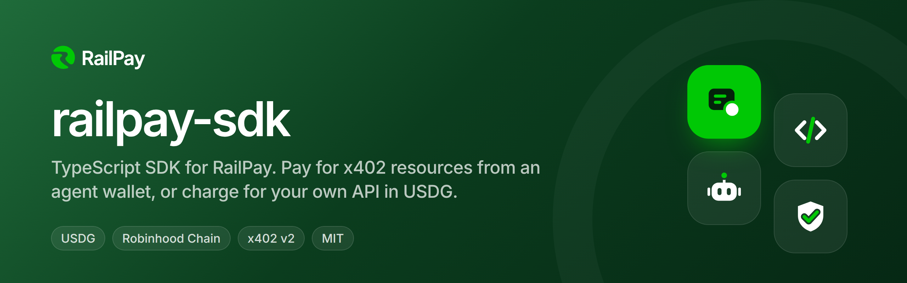

# railpay-sdk

TypeScript SDK for [RailPay](https://railpay.app): stablecoin payments on Robinhood Chain.

- **Pay** for x402 resources from a RailPay agent wallet: `withPayment(fetch)` answers a `402 Payment Required` and retries.
- **Charge** for your own API in USDG: `createPaywall()` returns the 402, verifies the payment, settles it and serves the response.

Settlement is real: USDG (Global Dollar, 6 decimals) on Robinhood Chain (chain id 4663), using x402 v2, scheme `exact`, with EIP-3009 `TransferWithAuthorization`.

## Install

The package is not on npm yet. Install it from the GitHub release tarball:

```sh
pnpm add https://github.com/railpayapp/railpay-sdk/releases/download/v0.1.0/railpay-sdk-0.1.0.tgz
# or: npm install https://github.com/railpayapp/railpay-sdk/releases/download/v0.1.0/railpay-sdk-0.1.0.tgz
```

The tarball is built, so nothing runs at install time. Installing straight from git (`github:railpayapp/railpay-sdk`) needs a build step, which pnpm 10+ blocks unless you add the package to `allowBuilds`.

The one runtime dependency is [viem](https://viem.sh). It runs on Node 20+, Bun, Deno and Cloudflare Workers.

## Pay for an x402 resource (agent)

Create an agent in the [RailPay dapp](https://dapp.railpay.app), set its policy (per-request max, daily cap, allowed hosts, allowed recipients), fund its wallet with USDG and create an agent key (`rp_sk_…`).

```ts
import { RailPay, withPayment, readPaymentResponse, fromUnits } from "railpay-sdk";

const railpay = new RailPay({ apiKey: process.env.RAILPAY_AGENT_KEY });
const paidFetch = withPayment(railpay, { maxAmount: "0.05" });

const res = await paidFetch("https://dapp.railpay.app/x402/time");
console.log(await res.json());
console.log(readPaymentResponse(res)?.transaction); // settlement tx hash
```

What happens:

1. The first request gets `402` with a `PAYMENT-REQUIRED` header.
2. If one of the accepted options is `exact` / `eip155:4663` / USDG, the SDK asks RailPay (`POST /v1/agent/pay`) to sign an EIP-3009 authorization from the agent wallet. RailPay checks the agent's policy first.
3. The request is retried once with `PAYMENT-SIGNATURE`. The seller settles the authorization on-chain.

If no option is payable, the original 402 comes back unchanged. A price above `maxAmount` throws `RailPayError` with code `over_max_amount` before anything is signed. POST bodies are kept and sent again on the retry.

## Charge for your API (seller)

```ts
import { createPaywall } from "railpay-sdk";

const paywall = createPaywall({
  payTo: "0xYourWallet",
  price: "0.01", // USDG per request, at least 0.001
  description: "Daily market report",
});

// Any Fetch API runtime: Cloudflare Workers, Bun, Deno, Next.js route handlers
export default {
  fetch: (request: Request) => paywall.handle(request, () => Response.json({ report: "…" })),
};

// Hono
app.get("/report", (c) => paywall.handle(c.req.raw, () => c.json({ report: "…" })));
```

`handle(request, serve)`:

1. No payment: answers `402` with the requirement (`PAYMENT-REQUIRED` header and the same JSON in the body).
2. With `PAYMENT-SIGNATURE` (or `X-PAYMENT`): checks recipient, amount, validity window and signature, then reads the payer's USDG balance and the authorization nonce from the chain.
3. Sends the authorization to an x402 facilitator to settle.
4. Reads the transaction receipt and looks for the exact USDG transfer, payer → `payTo`, for the price. A facilitator's "success" alone is not trusted.
5. Calls `serve()` once and adds `PAYMENT-RESPONSE` with the transaction hash.

If the transfer is broadcast but not confirmed yet, the answer is `402 settlement_pending`. Retrying with the same payment serves the resource once the transfer is on-chain. A payment unlocks one response. Replays get `invalid_payload`.

### Gas and facilitators

Settlement goes through outside x402 facilitators that pay the gas and charge no key: [Toll](https://x402.t0ll.xyz) first, then [Primer](https://x402.primer.systems). They are third-party services, not run by RailPay, and they have their own limits (Toll: 0.001 to 100 USDG per payment). You can pass your own list with `facilitators`. A RailPay relayer is coming soon.

### Running on more than one instance

The default `memoryStore()` remembers payments inside one process. Once a payment is settled its nonce is spent on-chain, so a replay sent to another instance is refused anyway. The gap is two instances settling the same authorization at the same moment. On serverless platforms or with several replicas, pass a shared `store` whose `claim()` is an atomic insert-if-absent (a database row with a unique key, Redis `SET NX`, a Durable Object).

```ts
interface PaymentStore {
  claim(key: string, value: StoredPayment): Promise<boolean>; // false if the key exists
  get(key: string): Promise<StoredPayment | undefined>;
  set(key: string, value: StoredPayment): Promise<void>;
  delete(key: string): Promise<void>;
}
```

## API

### `new RailPay({ apiKey?, baseUrl?, fetch? })`

| Method | Auth | Returns |
|---|---|---|
| `me()` | agent key | the agent: address, USDG `balance` (base units), `eth`, `spent_today`, `policy` |
| `pay(paymentRequired, resourceUrl?)` | agent key | `{ payment, header, authorization, valid_before, amount, spent_today }` |
| `send({ to, amount, memo? })` | agent key | agent-to-agent payment `{ tx_hash, tx_url, amount }`. Needs `allow_a2a`, and the paying agent wallet pays the gas in ETH |
| `config()` | public | network, USDG, facilitators, relayer status |
| `stats()` | account key | network stats for signed-in accounts: every recorded payment, outside vs team |
| `request(method, path, body?)` | | any other endpoint |

API errors throw `RailPayError` with `status`, `code` and `message`. Policy refusals are `403` with code `paused`, `over_per_request`, `over_daily_cap`, `host_not_allowed`, `pay_to_not_allowed`, `a2a_not_allowed`, `insufficient_funds` or `insufficient_gas`, and each one is logged on the agent in the dapp.

### `withPayment(client, { fetch?, maxAmount?, onPayment? })`

Returns a `fetch`-compatible function. `maxAmount` is a USDG decimal string or base units as a `bigint`.

### `createPaywall({ payTo, price, description?, mimeType?, facilitators?, rpcUrl?, store?, fetch?, receiptWaitMs? })`

Returns `{ price, payTo, requirements(url), handle(request, serve) }`. `rpcUrl` defaults to `https://robinhood-rpc.publicnode.com`.

### Helpers

- `toUnits("1.5")` → `1500000n`, `fromUnits(1500000n)` → `"1.5"`
- `readPaymentRequired(response)`, `readPaymentResponse(response)`, `isRailPayPayable(requirement)`
- `b64json(value)`, `unb64json(string)`
- Constants: `CHAIN_ID`, `NETWORK`, `USDG`, `USDG_DECIMALS`, `USDG_EIP712`, `DEFAULT_FACILITATORS`, `MIN_X402_AMOUNT`, `EXPLORER`, `txUrl(hash)`

## Security

- An agent key can spend from the agent wallet within its policy. Keep it on a server, never in a browser bundle. Set a daily cap and allowlists in the dapp.
- `withPayment` signs only USDG on Robinhood Chain. Use `maxAmount` as a second limit on top of the policy.
- Report vulnerabilities to founder@railpay.app (see [SECURITY.md](SECURITY.md)).

## Development

```sh
pnpm install
pnpm typecheck && pnpm test && pnpm build
pnpm smoke   # read-only check against https://dapp.railpay.app, spends nothing
```

## Links

- Website: https://railpay.app
- Docs: https://docs.railpay.app
- Dapp: https://dapp.railpay.app
- MCP server: https://github.com/railpayapp/railpay-mcp

## License

[MIT](LICENSE)
